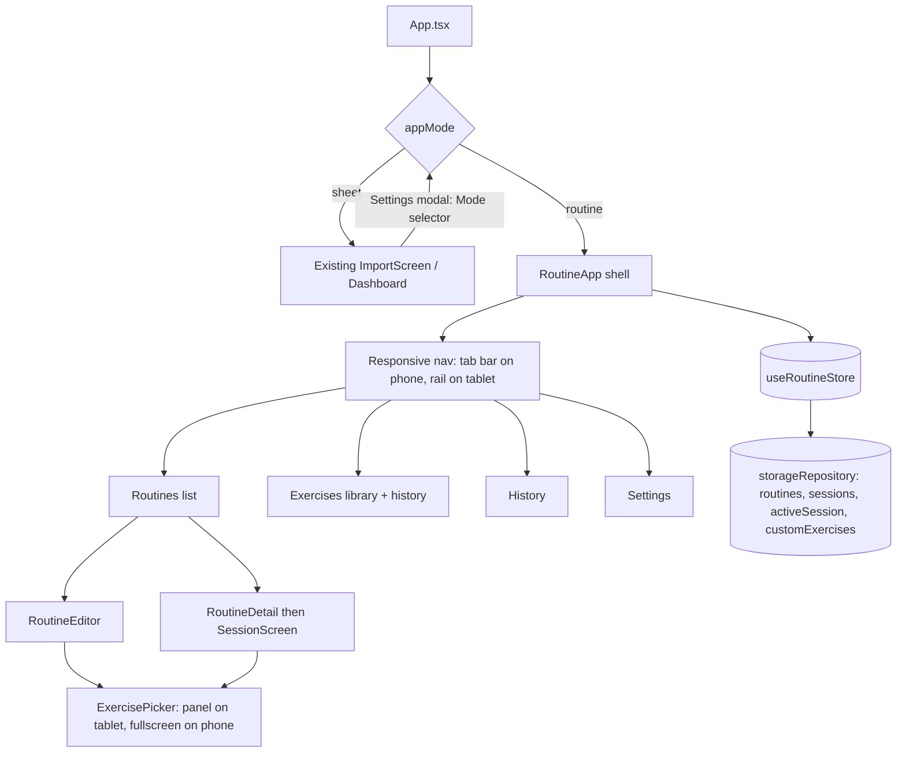

# IronTrack v0.6.0: Routine Mode (plan)

> Target version: **0.6.0** (new feature module, minor bump per README convention; current is 0.5.2).
> Status: planned, not implemented yet. Approved decisions: bundled bilingual exercise library, RPE 1-10 with reps-left labels, log vs. routine separation, last-time-as-goal rule, JSON export/import, Mode selector in Settings.

## Routine Mode for IronTrack

## Goal Description

Add a second app mode, **Routine mode**, inspired by the Hevy "Create Routine" screenshot but built mobile-first (phone and tablet). The existing experience (import spreadsheet → weeks/days → Classic/OnTrain) is renamed **Sheet mode** and stays untouched.

Routine mode lets you:
- **Create routines**: name them, pick exercises from a searchable library, then edit per-set weight, reps and **planned RPE**.
- **Play a routine**: log per-set weight, reps and **measured RPE**, with a note per exercise. You can add, remove or reorder exercises mid-session.
- **See history per exercise** (not per routine): the last 2 times you did an exercise appear as a compact list on its card, whichever routine it was in.
- **Save and reuse routines.** Editing a routine asks "update this one or save as new?". If the session's structure changed, finishing asks you to save it as a new routine under a new name.
- **Export and import** routines and workout logs as JSON.

The mode is chosen in **Settings** and remembered. It changes the whole shell: navigation, screens and layout.

### Findings from the codebase

| Finding | Consequence |
|---|---|
| The project is **Vite + React 18 + Tailwind + Capacitor 6**, not bare React Native as [AGENTS.md](file:///var/mnt/dados/Projetos/vibeProjects/irontrack/AGENTS.md) says. | I follow the real stack: Tailwind, `lucide-react`, `react-i18next`, and the existing `gym-*` colors. The AGENTS.md conventions that still apply (functional components, named exports, strict TS, no `any`, `*.test.tsx`, Conventional Commits, build and `adb install -r`) are followed. |
| There is no router. [App.tsx](file:///var/mnt/dados/Projetos/vibeProjects/irontrack/App.tsx) renders `ImportScreen` when `workouts.length === 0`, otherwise `Dashboard` (1100 lines). | Routine mode must bypass the `ImportScreen` gate, so `App.tsx` branches on `appMode` first. |
| Persistence is `storageRepository` ([storageRepository.ts](file:///var/mnt/dados/Projetos/vibeProjects/irontrack/services/storageRepository.ts)): a key-value store on SQLite (Android) or Preferences (web). | Add new keys and reuse `get`/`set`. No schema migration is needed, and sheet-mode keys are untouched. |
| The settings modal is inline in [Dashboard.tsx](file:///var/mnt/dados/Projetos/vibeProjects/irontrack/components/Dashboard.tsx#L993-L1091). | Add the Mode selector there, with a tiny shared component. The Dashboard is otherwise not refactored. |
| Sheet mode already has per-exercise history keyed by normalized exercise **name** (`exerciseHistory`). | Routine mode keys history by stable **exercise id**, because names can be PT or EN. Sheet history is left alone. |
| The card style is `bg-gym-800 border-gym-700 rounded-xl`, with lucide icons and a `RestTimer`. | I reuse the look, `RestTimer` and `NotificationTimer` for routine mode. |
| There is no test runner in `package.json`. | Add `vitest` (devDependency) for the pure logic. Component tests use `@testing-library/react` (jsdom). |
| The UI language is PT-BR by default, with EN. | All new strings go into [i18n.ts](file:///var/mnt/dados/Projetos/vibeProjects/irontrack/i18n.ts) in both languages. Library exercise names are bilingual and follow the active language. |

---

## User Review Required

> [!IMPORTANT]
> **Log and routine are two separate things (confirmed):**
> - **Log:** every finished session is saved to History automatically. It feeds "last 2 times" and the JSON export.
> - **Saved routine, structure:** if you added, removed or reordered exercises, or changed a set count, finishing *asks* "Save this as a new routine?" with a name field pre-filled `"<Routine> (2)"`. Options: **Save as new** or **No, just log it**. Changing only weight, reps or RPE does not trigger this prompt. The routine's structure (which exercises, how many sets) is never changed without asking.
>
> **Goals to beat (new rule you just asked for):**
> - The **planned** weight, reps and RPE for an exercise are always **what you did the last time you did that exercise**. That is the goal to overcome.
> - The source is **by exercise, across all routines**. If you did Deadlift in routine A yesterday, routine B shows yesterday's numbers as its goal today.
> - Only sets you ticked as **done** count. For the planned RPE, your **measured** RPE from last time becomes the new planned RPE. If you left it as `-`, the previous planned RPE is kept.
> - When you finish a session, the **routine you ran is updated automatically** with those new targets, so the routine editor and routine list always show the current goals. This is a deliberate exception to "never change a routine without asking", and it only touches the weight, reps and RPE of sets that already exist. It never changes the structure.
> - When you save a changed session as a **new routine**, its targets are what you actually did.
> - The session screen shows a small ▲ on a set where you beat the goal (more weight, or the same weight with more reps).
>
> Details are in section 1 (`goals.ts`) and the session and finish sections below.

> [!NOTE]
> **Decisions I'm making (tell me if you disagree):**
> - **Weight is kg only** in routine mode. Sheet mode's kg/bars/dumbbell unit selector is not carried over, to keep the set table compact on a phone.
> - **RPE** is a 1–10 select with `-` as "not set". Each option shows the reps left (10 = 0 left, 9 = 1, 8 = 2, 7 = 3, ≤6 = 4+).
> - **Navigation** is a bottom tab bar on phones (Routines · Exercises · History · Settings) and a left side rail on tablets, as in your screenshot.
> - **Back button:** I add `@capacitor/app` so the Android back button closes sub-screens and dialogs instead of exiting the app. This needs `npx cap sync android`.
> - **Resume session:** the in-progress session is auto-saved after every edit, so a killed app doesn't lose your workout. Routines show a "Resume workout" banner.
> - **Duplicate exercises:** you can add the same exercise twice to a routine.
> - **Library size:** about 180 exercises, written from common standard exercise lists. No online fetching.
> - **Out of scope for now:** Google Sheets sync of routine data, plate calculator, body-map graphic, drag-and-drop on phones (up/down buttons are used instead).

---

## Open Questions

> [!NOTE]
> No blocking questions remain. The items above are the assumptions I will implement unless you change them.

---

## Architecture



### New folder (feature-based, isolated from sheet mode)

```
features/routine/
  types.ts                 # domain types
  data/exerciseLibrary.ts  # bundled ~180 exercises (bilingual)
  utils/
    rpe.ts                 # RPE to reps-left label
    history.ts             # getLastPerformances(), compactSets()
    goals.ts               # buildGoalSets(), applySessionToRoutine(), beatGoal()
    sessionDiff.ts         # hasStructureChanged(routine, session)
    routineExport.ts       # build / parse / merge JSON
    ids.ts                 # uid()
  hooks/
    useRoutineStore.ts     # load/persist routines, sessions, custom exercises, active session
    useMediaQuery.ts       # 'md' breakpoint for structural layout switches
    useNavStack.ts         # typed screen stack plus Android back-button handling
  components/
    RoutineApp.tsx         # shell and navigation
    RoutinesScreen.tsx     # list, create, start, resume banner
    RoutineEditor.tsx      # name, exercise cards, summary, save dialog
    ExercisePicker.tsx     # search plus muscle and equipment filters
    ExercisesScreen.tsx    # library browse plus per-exercise history sheet
    SetTable.tsx           # shared set rows (planned mode and session mode)
    SessionScreen.tsx      # play a routine
    SessionExerciseCard.tsx
    LastPerformances.tsx   # compact "last 2 times" list
    FinishSessionDialog.tsx
    HistoryScreen.tsx      # past sessions list and detail
    ModeSelector.tsx       # reused in Settings (both modes)
    RoutineSettings.tsx    # mode, language, export/import JSON
```

---

## Proposed Changes

### 1. Domain types and data

#### [NEW] [features/routine/types.ts](file:///var/mnt/dados/Projetos/vibeProjects/irontrack/features/routine/types.ts)

```ts
export type AppMode = 'sheet' | 'routine';
export type RpeValue = '-' | '1' | '2' | '3' | '4' | '5' | '6' | '7' | '8' | '9' | '10';

export type MuscleGroup =
  | 'chest' | 'back' | 'lats' | 'shoulders' | 'biceps' | 'triceps' | 'forearms'
  | 'abs' | 'lower_back' | 'quads' | 'hamstrings' | 'glutes' | 'calves'
  | 'traps' | 'cardio' | 'full_body';
export type Equipment =
  | 'barbell' | 'dumbbell' | 'machine' | 'cable' | 'bodyweight'
  | 'kettlebell' | 'band' | 'smith' | 'other';

export interface ExerciseDef {
  id: string;                          // stable, e.g. 'barbell-deadlift'; custom: 'custom-<uid>'
  names: { en: string; 'pt-BR': string };
  muscle: MuscleGroup;                 // primary muscle (used for filter and search)
  equipment: Equipment;
  isCustom?: boolean;
}

export interface PlannedSet { id: string; weightKg: string; reps: string; rpePlanned: RpeValue }
export interface RoutineExercise { id: string; exerciseId: string; note: string; sets: PlannedSet[] }
export interface Routine {
  id: string; name: string; note: string;
  exercises: RoutineExercise[];
  createdAt: string; updatedAt: string;
}

export interface SessionSet {
  id: string;
  plannedWeightKg: string; plannedReps: string; rpePlanned: RpeValue; // snapshot of the plan
  weightKg: string; reps: string; rpeMeasured: RpeValue;               // what actually happened
  done: boolean;
}
export interface SessionExercise {
  id: string; exerciseId: string;
  exerciseName: string;                // snapshot so old logs survive library changes
  muscle: MuscleGroup;
  note: string;                        // the annotation field
  sets: SessionSet[];
}
export interface WorkoutSession {
  id: string;
  routineId: string | null; routineName: string;
  startedAt: string; finishedAt: string | null;
  exercises: SessionExercise[];
}
```

Sessions snapshot names and the plan, so editing or deleting a routine never rewrites history.

#### [NEW] [features/routine/data/exerciseLibrary.ts](file:///var/mnt/dados/Projetos/vibeProjects/irontrack/features/routine/data/exerciseLibrary.ts)

About 180 entries in `{ id, names:{en,'pt-BR'}, muscle, equipment }` form, for example:

```ts
{ id: 'barbell-deadlift',   names: { en: 'Deadlift (Barbell)',        'pt-BR': 'Levantamento Terra (Barra)' }, muscle: 'lower_back', equipment: 'barbell' },
{ id: 'barbell-bench-press', names: { en: 'Bench Press (Barbell)',    'pt-BR': 'Supino Reto (Barra)' },        muscle: 'chest',      equipment: 'barbell' },
{ id: 'barbell-squat',      names: { en: 'Squat (Barbell)',           'pt-BR': 'Agachamento (Barra)' },        muscle: 'quads',      equipment: 'barbell' },
```

It covers all muscle groups, including the sheet-mode movements (Agachamento, Supino, Terra). I will cross-check the names against public exercise lists while authoring it.

**Search rule** (in `ExercisePicker`): case- and accent-insensitive substring match on the exercise name in **both languages** OR on the localized muscle name. For example, typing "peito" or "chest" returns chest exercises, and "supino" returns bench variants. Filters for muscle and equipment can be combined with the text search.

#### [NEW] `utils/goals.ts` (last time becomes the goal)

```ts
// Goal for each set of a routine exercise, from the last performance of that exercise
// (by exerciseId, across ALL routines). Only 'done' sets of finished sessions count.
export const buildGoalSets = (
  template: PlannedSet[], last: Performance | null,
): PlannedSet[] =>
  template.map((tpl, i) => {
    const done = last?.sets ?? [];
    const src = done[i] ?? done[done.length - 1];     // fewer sets than before: reuse the last one
    if (!src) return tpl;                              // never done: use the routine's own values
    return {
      ...tpl,
      weightKg: src.weightKg,
      reps: src.reps,
      rpePlanned: src.rpeMeasured !== '-' ? src.rpeMeasured : tpl.rpePlanned,
    };
  });

// After finishing: copy the performed values into the SOURCE routine.
// Structure (exercise list, set count) is never changed here.
export const applySessionToRoutine = (routine: Routine, session: WorkoutSession): Routine => { /* ... */ };

// ▲ indicator: more weight, or the same weight with more reps
export const beatGoal = (s: SessionSet): boolean => { /* ... */ };
```

Edge cases:
- An exercise that was never done keeps the routine's own values as its goal.
- Sets that were not ticked as done are ignored, so a skipped set doesn't lower the goal.
- If last time had more sets than the routine now has, the extra sets are ignored. Adding sets is a structure change, which is handled by the "save as new routine" prompt.
- The goal always follows the **most recent** finished session, so a bad day lowers the next goal. This follows your rule "the last time is the goal". If you would rather keep the best-ever value as the goal, tell me.

#### [NEW] utils: `rpe.ts`, `history.ts`, `sessionDiff.ts`, `ids.ts`

```ts
// rpe.ts
export const repsLeftForRpe = (rpe: RpeValue): string | null => {
  if (rpe === '-') return null;
  const n = Number(rpe);
  return n >= 10 ? '0' : n >= 7 ? String(10 - n) : '4+';
};

// history.ts: keyed by exerciseId, across ALL routines
export interface Performance { sessionId: string; date: string; sets: SessionSet[]; note: string }
export const getLastPerformances = (
  sessions: WorkoutSession[], exerciseId: string,
  opts: { limit?: number; excludeSessionId?: string } = {},
): Performance[] => { /* finished sessions, newest first, only done sets, limit default 2 */ };

// "2× 30kg×5 @8 · 35kg×3 @9": merges consecutive identical sets
export const compactSets = (sets: SessionSet[]): string => { /* ... */ };

// sessionDiff.ts
export const hasStructureChanged = (routine: Routine | null, s: WorkoutSession): boolean => {
  if (!routine) return true;
  const a = routine.exercises.map(e => `${e.exerciseId}:${e.sets.length}`);
  const b = s.exercises.map(e => `${e.exerciseId}:${e.sets.length}`);
  return a.length !== b.length || a.some((x, i) => x !== b[i]);
};
```

---

### 2. Storage

#### [MODIFY] [storageRepository.ts](file:///var/mnt/dados/Projetos/vibeProjects/irontrack/services/storageRepository.ts)

Add keys only; no schema change:

```ts
export const STORAGE_KEYS = {
  ...,
  appMode: 'irontrack_app_mode',
  routines: 'irontrack_routines',
  routineSessions: 'irontrack_routine_sessions',
  routineActiveSession: 'irontrack_routine_active_session',
  customExercises: 'irontrack_custom_exercises',
} as const;
```

The new keys are also added to `LEGACY_PREFERENCES_KEYS` so the Preferences→SQLite migration covers them.

> [!NOTE]
> Sheet mode's **Replace/Reset import** calls `clearKeys` on sheet keys only, so it will not delete routines or logs. I will verify this in `clearData`.

#### [NEW] [useRoutineStore.ts](file:///var/mnt/dados/Projetos/vibeProjects/irontrack/features/routine/hooks/useRoutineStore.ts)

A single hook that exposes the following (persisting through `storageRepository`):

| API | Behavior |
|---|---|
| `routines`, `sessions`, `customExercises`, `activeSession` | State, loaded on mount. |
| `saveRoutine(routine, mode: 'update' \| 'new')` | `update` replaces by id and bumps `updatedAt`. `new` creates a new id. |
| `deleteRoutine(id)`, `duplicateRoutine(id)` | History is not affected. |
| `startSession(routineId \| null)` | Builds a `WorkoutSession` from the routine and persists it as `activeSession`. Each set's goal comes from `buildGoalSets` (last performance of that exercise in any routine, otherwise the routine's own values) and is snapshotted into the set. |
| `updateActiveSession(updater)` | Persists after each change (debounced about 300 ms). |
| `finishSession()` | Sets `finishedAt`, appends to `sessions`, runs `applySessionToRoutine` on the source routine (new goals, structure untouched), and clears `activeSession`. Returns the session. |
| `discardSession()` | Clears `activeSession`. |
| `addCustomExercise(def)` | Stored with `custom-` id. |
| `getLastPerformances(exerciseId, opts)` | Memoized wrapper of the util. |
| `exportData()` / `importData(json, 'merge' \| 'replace')` | See section 6. |

---

### 3. App shell and mode switch

#### [MODIFY] [App.tsx](file:///var/mnt/dados/Projetos/vibeProjects/irontrack/App.tsx)

- Read `appMode` (default `'sheet'`, so existing users see no change) from the repository.
- If `appMode === 'routine'` render `<RoutineApp onChangeMode={...} />` and skip the `workouts.length === 0` import gate.
- Otherwise the current tree is unchanged.
- Hooks stay unconditional. `useWorkoutStorage` is still called; this is cheap and avoids hook-order issues.

#### [MODIFY] [Dashboard.tsx](file:///var/mnt/dados/Projetos/vibeProjects/irontrack/components/Dashboard.tsx)

- New optional prop `onChangeAppMode`.
- A **Mode** row is added at the top of the existing settings modal (`ModeSelector`: "Sheet mode" / "Routine mode"). Nothing else in this 1100-line file changes.
- Terminology: the OnTrain/Classic header toggle keeps its current labels. The sheet mode label is only used for the app mode.

#### [NEW] `ModeSelector.tsx`

A two-option segmented control, styled like the existing settings rows. It is used in both Sheet Settings and Routine Settings.

---

### 4. Responsive layout (phone and tablet)

| Area | Phone (< 768px) | Tablet (≥ 768px) |
|---|---|---|
| Navigation | Fixed bottom tab bar with 4 tabs, safe-area padding | Left side rail with icons and labels, as in the screenshot |
| Routine editor | Single column. "Add exercises" opens the **full-screen picker**. A sticky bottom bar shows `N exercises · M sets` and **Save** | **Two panes**: editor on the left (flex-1), **Library panel** (about 360px) on the right with a Summary card on top, like the screenshot |
| Set rows | Compact grid `# · kg · reps · RPE`, 44px touch targets | Same grid with more room, and a planned/last column |
| Session | One column of cards. A sticky top bar shows the elapsed time and **Finish** | Cards in a 2-column grid in landscape, with an "Add exercise" side panel |
| Exercises screen | List, with history as a bottom sheet | List and history **side by side** |

Implementation: Tailwind `md:`/`lg:` classes for styling. `useMediaQuery('(min-width: 768px)')` for structural switches (picker as panel vs. full-screen). The routine shell uses the full width (up to about `max-w-6xl`). Sheet mode's `max-w-3xl` is unchanged.

[tailwind.config.js](file:///var/mnt/dados/Projetos/vibeProjects/irontrack/tailwind.config.js) `content` gets `./features/**/*.{ts,tsx}`.

The theme, colors and icons stay as they are today.

---

### 5. Screens

#### [NEW] `RoutinesScreen.tsx`
- Header: "Routines" and **+ New Routine**.
- A "Resume workout" banner appears if `activeSession` exists.
- Routine cards show the name, exercise count, set count and muscle chips, and when it was last done. Actions: **▶ Start**, **Edit** and a ⋮ menu (duplicate, delete with confirmation).
- Empty state: a call to create the first routine.

#### [NEW] `RoutineEditor.tsx` (mirrors the screenshot)
1. **Routine Title** input. It is required, and Save is disabled until it's filled, like the grey Save button.
2. **Add exercises** step: picker (see below). Tapping an exercise adds it. A check badge and a count appear on added items, and you can tap again to add a second set of that exercise.
3. After you press **Done**, each exercise is a card with:
   - Name and muscle chip, with a ⋮ menu (move up, move down, remove).
   - **Note** field (pinned note).
   - **Set table:** `SET · KG · REPS · RPE (planned)`, with a remove-set ✕ and **+ Add Set** (copies the previous set's values). Each set has its own weight, reps and RPE, so "2×30kg×5 then 1×35kg×3" works.
   - A compact **last 2 times** line for that exercise, as a planning aid.
4. **Summary card** (exercise count and total sets).
5. **Save:** on a new routine, it saves directly. When editing an existing routine, a dialog asks **"Update this routine"** / **"Save as new routine"** (with a name field) / **Cancel**.

#### [NEW] `ExercisePicker.tsx`
Search box (name or muscle, either language), muscle filter, equipment filter, and a **+ Custom Exercise** form (name, muscle, equipment). Rows show the localized name and muscle. Rendered as a right panel on tablet and a full-screen overlay on phone (with `BackHandler`-equivalent back handling). It uses `FlatList`-style windowing only if needed. About 180 rows render fine with a plain list, but I'll cap the initial render and lazy-load on scroll to be safe on low-end phones.

#### [NEW] `SessionScreen.tsx` and `SessionExerciseCard.tsx` ("play")
- Top bar: routine name, **elapsed timer**, **Finish**. A ✕ asks to discard.
- One card per exercise in the existing card style. Each card shows:
  - Title and muscle.
  - **Last 2 times** (`LastPerformances`): two small rows, e.g. `28/10 · 2× 30kg×5 @8 · 35kg×3 @9`, plus the note icon and text if one was saved. Not a full card, just a list, and it is looked up by `exerciseId` from any routine.
  - **Set table:** `SET · GOAL · KG · REPS · RPE · ✓`. The **GOAL** column shows what you did last time for that exercise, e.g. `30×5 @8` (muted), taken from `buildGoalSets`. The KG and REPS inputs are prefilled from the goal and editable. The RPE select is the **measured** RPE, and ✓ marks the set done. A small ▲ appears on a set that beats its goal. Checking a set starts the existing `RestTimer` and `NotificationTimer`.
  - **Annotation** textarea (same field style as sheet mode).
  - **+ Add Set**, and ⋮ for remove exercise and move up/down.
- **+ Add exercise** at the bottom opens the picker. New exercises start with 3 empty sets (or the last performance's sets, if one exists). Removing an exercise asks for confirmation if it has completed sets.
- Auto-saved to `activeSession` on each change.

#### [NEW] `FinishSessionDialog.tsx`
1. Summary: duration, sets done, volume (kg × reps), and how many sets beat their goal.
2. **Log (automatic):** the session is always appended to history.
3. **Goals (automatic):** if the session came from a routine, `applySessionToRoutine` updates that routine's weight, reps and planned RPE for the sets you did, so they become the next goals. The routine's structure is not touched.
4. **Structure (asked):** if `hasStructureChanged(routine, session)`, show the "Save this as a new routine?" form (name pre-filled `"<Routine> (2)"`), with **Save as new** and **No, just log it**. **Save as new** adds a routine to the Routines menu, using what you actually did as its targets.

#### [NEW] `ExercisesScreen.tsx`
Full library with the same search and filters. Tapping an exercise opens its **history** (the last sessions with every set's weight, reps, planned and measured RPE, and notes, newest first) and lets you create custom exercises.

#### [NEW] `HistoryScreen.tsx`
List of finished sessions (date, routine, volume) with a detail view. Delete is available with confirmation.

#### [NEW] `RoutineSettings.tsx`
Mode selector, language (reusing the existing toggle logic), export JSON and import JSON.

---

### 6. Export and import (JSON)

#### [NEW] `routineExport.ts`

```ts
interface RoutineBackup {
  schema: 'irontrack.routines.v1';
  exportedAt: string;
  routines: Routine[];
  sessions: WorkoutSession[];
  customExercises: ExerciseDef[];
}
```

- **Export:** writes `irontrack_routines_<timestamp>.json` to `Directory.Documents` via `@capacitor/filesystem`, the same approach as [exportCsv.ts](file:///var/mnt/dados/Projetos/vibeProjects/irontrack/utils/exportCsv.ts), and shows the path.
- **Import:** `@capawesome/capacitor-file-picker`, as in [ImportScreen.tsx](file:///var/mnt/dados/Projetos/vibeProjects/irontrack/components/ImportScreen.tsx). The file is validated with a type-guard parser (no `any`, and the schema version is checked). Then it asks **Merge** (by id; the newer `updatedAt` wins for routines, and sessions are unioned by id) or **Replace**. Invalid files show a localized error.

---

### 7. i18n

#### [MODIFY] [i18n.ts](file:///var/mnt/dados/Projetos/vibeProjects/irontrack/i18n.ts)

About 80 new keys under a `routine_*` prefix, in EN and PT-BR. Examples: `mode_sheet` ("Sheet mode"/"Modo planilha"), `mode_routine` ("Routine mode"/"Modo rotina"), `routines`, `exercises`, `history`, `routine_title`, `add_exercises`, `rpe_planned`, `rpe_measured`, `last_two_times`, `save_as_new_routine`. Muscle and equipment labels are included.

---

### 8. Dependencies and config

| Change | Why |
|---|---|
| `+ @capacitor/app` | Hardware back button handling. Needs `npx cap sync android`. |
| `+ vitest`, `jsdom`, `@testing-library/react`, `@testing-library/jest-dom` (dev) | The project has no test runner today. |
| `tailwind.config.js` content glob | Include `features/**`. |
| `package.json` | Add `test` script, bump version to **0.6.0** (new feature module, per the README convention), and update the README/TODO. |
| Android | No manifest changes expected. |

---

## Verification Plan

### Automated Tests
```bash
npx vitest run      # new pure-logic and component tests
npx tsc --noEmit    # strict type check
npm run build       # vite production build
```

New tests (colocated):
- `history.test.ts`: last 2 per `exerciseId` across different routines, excludes the active session, skips unfinished sessions, and `compactSets` merges identical sets.
- `sessionDiff.test.ts`: it detects an added, removed or reordered exercise and a changed set count, and it ignores weight, reps and RPE edits.
- `goals.test.ts`: the goal comes from the last performance of the same exercise even if it was done in another routine, only done sets count, measured RPE becomes planned RPE (and `-` keeps the previous one), extra sets fall back to the last set's values, `applySessionToRoutine` updates values but never the structure, and `beatGoal` flags more weight or same weight with more reps.
- `rpe.test.ts`: reps-left mapping.
- `routineExport.test.ts`: round-trip, merge conflict resolution, and rejecting malformed JSON.
- `ExercisePicker.test.tsx`: text search matches by name (PT and EN) and by muscle, and the filters combine.
- `RoutineEditor.test.tsx`: per-set independent values, and the update vs. save-as-new dialog on edit.
- `SessionScreen.test.tsx`: planned and measured RPE are stored separately, the "last 2" list shows, and finishing a modified session shows the save prompt.

### Manual Verification (on device)
1. `npm run build:apk`, then `adb install -r android/app/build/outputs/apk/release/app-release.apk` (per AGENTS.md).
2. **Existing data intact:** open the app and confirm it opens in Sheet mode with your weeks, days, 1RM and history unchanged.
3. Settings → switch to Routine mode: the whole shell changes, and it is remembered after restarting the app.
4. Create a routine (e.g. Deadlift 2 sets, one at 30kg×5 and one at 35kg×3, each with a different planned RPE). Search "peito" and "back" and check the matching.
5. Run it: edit weight, reps and measured RPE, add an exercise, remove one, write a note, then finish and take the save-as-new path.
6. Start a **different** routine that contains the same exercise and confirm the "last 2 times" list shows the earlier sets, RPE and note.
7. Edit a routine and check the Update / Save as new dialog.
8. Kill the app mid-session and check that Resume restores it.
9. Export JSON, clear the data, import (merge and replace), and compare.
10. Check phone portrait and tablet landscape layouts (an emulator at about 360×800 and about 1280×800), including the Android back button on the picker and dialogs.
11. Switch back to Sheet mode and confirm nothing regressed.
